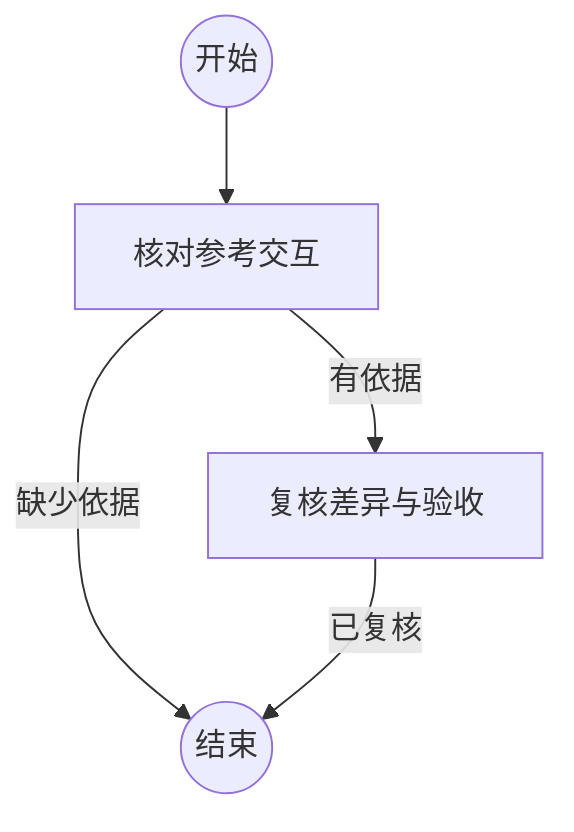

## 核对参考交互
```新建Agent
只读执行 {var.任务}。若当前节点缺少文件读取与命令执行工具，直接提交“缺少依据”，禁止递归调用本流程。检查参考实现和目标实现，列出用户可操作的交互、数据依赖、实际差异与精确源码位置。明确已实现、遗漏、数据源无法提供三种状态。禁止修改文件、提交代码或重启服务。
```
### 有依据
已找到实现证据，可以复核差异与验收要求。
### 缺少依据
参考实现不可访问，明确记录缺少的证据。
## 复核差异与验收
```复用Agent
检查刚才的差异是否都有源码依据。给每个遗漏列出可观察的验收动作，重点覆盖组合操作、状态复位、输入取消、缺失数据。输出紧凑对照表与优先修复项。不得将数据源缺失等同于已经实现。继续只读，不修改文件。
```
### 已复核
差异与验收动作已逐项复核，结果可用于实现和独立验收。
